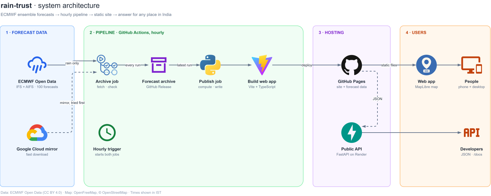

# rain-trust

**Will it rain where you are in India, when, and how far can you trust that?**

rain-trust turns ECMWF's open ensemble forecasts into a direct answer for one place, and shows how much to trust it:
how many of 100 forecasts agree, whether the physics model and the AI model agree (and *how* they differ), and how
much the forecast changed since the previous run.

- **Live app:** https://ishansurdi.github.io/rainsure/ (try [Chennai](https://ishansurdi.github.io/rainsure/?lat=13.08&lon=80.27&name=Chennai%2C%20Tamil%20Nadu), [Kochi](https://ishansurdi.github.io/rainsure/?lat=9.93&lon=76.27&name=Kochi%2C%20Kerala), [Delhi](https://ishansurdi.github.io/rainsure/?lat=28.61&lon=77.21&name=Delhi))
- **API:** https://rain-trust-api.onrender.com · interactive docs: https://rain-trust-api.onrender.com/docs
  (free Render plan: sleeps after 15 min idle, about a minute to wake; the app does not need it)
- **PageSpeed Insights:** [run a fresh report](https://pagespeed.web.dev/analysis?url=https%3A%2F%2Fishansurdi.github.io%2Frainsure%2F%3Flat%3D13.08%26lon%3D80.27%26name%3DChennai) (results from 6 Nov 2026 below)
- **Every decision, with its reason and the rejected alternative:** [DECISIONS.md](DECISIONS.md) · plan and progress: [PLAN.md](PLAN.md)

## How to read it

- **100 forecasts.** ECMWF runs each forecast many times from slightly different starting conditions. We use 50 runs
  of the physics model **IFS** and 50 of the AI model **AIFS**. "54 of 100 forecasts show at least 2.5 mm" means 54 runs
  bring at least 2.5 mm (IMD's "rainy day" amount) in that 6-hour block.
- **Rain unlikely / likely / very likely / most likely** are IMD's probability words: under 25, 25–50, 51–75 and over
  75 of 100 forecasts (D50).
- **Forecast settled / fairly settled / unsettled** is about trust, not rain. Three checks: is it clear-cut (under 20 or
  over 80 of 100), do physics and AI agree (within 20 points), did it change little since the previous run (within 20
  points). All three: settled; two: fairly settled; fewer: unsettled. The sentence names what failed (D14, D15, D51).
- **How the models disagree** is said once, where it applies, from computed facts only: one model's rain is lighter,
  6 hours earlier or later, or up to 50 km away, or the models agree on the day but not the timing (D60).
- **Days run 05:30–05:30 IST** (00–00 UTC) in four 6-hour blocks: morning, afternoon, evening, night, always with times.
  Day totals use IMD rain categories applied to that window (D1, D16, D18).
- **Map layers:** *How likely?* (chance per block), *How much rain?* (median **day total**, IMD categories), *Do models
  agree?* (physics map, AI map, or the gap between them).

## Architecture

- **Hourly trigger:** GitHub's schedule plus a cron-job.org dispatch, because GitHub skips scheduled runs (D61, D64).
- **Archive job:** byte-range download of `tp` only (Google Cloud mirror first); every 00z/12z run's India `tp` for all 50 + 50 members goes to the GitHub release "archive" (~65 MB per
  run), after checks: members, steps, NaN, accumulation never drops beyond GRIB packing error, 6-h amounts under the
  WMO 12-h world record (D48). A bad run is not published; the previous one stays live.
- **Publish job:** newest complete run → de-accumulate → blocks/days → counts, percentiles, checks, disagreement rules,
  finished sentences (`process/`, `store/`) → point tiles, gzip map layers and `latest.json` on GitHub Pages.
- **Frontend** reads those files directly and never computes forecast values; the **API** reads the same JSON
  (`/meta`, `/point`, `/docs`) and the app does not need it.

### From forecast to answer

Modules depend downwards only: `api` → `store` → `process` → `common`; `ingest` → `process`/`common`.
Tests: `python -m unittest discover -s tests` (pipeline, 112 tests) and `npm --prefix frontend test` (frontend).

## Key decisions (details in DECISIONS.md)

- 05:30–05:30 IST day because AIFS is 6-hourly; IMD's 08:30 IST day cannot be built from it (D1).
- Units read from each GRIB message: IFS `m`, AIFS `kg m**-2` = mm; unknown units fail the run (D9).
- De-accumulation tolerance from GRIB `packingError`, not a fixed number (D46).
- Probabilities from per-member totals, never by adding block probabilities (D2).
- Pooled 100 forecasts with equal weight; when the models disagree, both numbers are shown (D29).
- Sentences are templates filled with computed values; the 48-h summary is capped at 200 characters (D50, D56).
- Answer card works from static files when the API sleeps (D52); sizes measured (D55, D57).
- India's official boundaries: Natural Earth India point of view, basemap borders and disputed labels removed and
  audited by listing every rendered label (D32, D41, D63).

## Findings from the data

**Where physics and AI disagree, the physics model is usually the lighter one.** Across all grid points and 6-hour
blocks where the two ensembles differ by 20 points or more (about 41,000 block-cells per run, 6.6 % of all), the types
were:

| How they differ | Run 2026110512 | Run 2026110412 |
|---|---|---|
| Lighter rain (both expect rain, one median under 2.5 mm) | 39.1 % | 37.6 % |
| Timing (6 h earlier/later) | 20.2 % | 19.7 % |
| Position (within 50 km) | 11.5 % | 10.6 % |
| Agree on the day, not the timing | 9.8 % | 10.7 % |
| Different outcomes | 19.4 % | 21.4 % |

In the "lighter rain" cases the AI model was the drier one in only 24 % and 33 % of cases, so the **physics model was
the lighter one in about 70 %**. 63 % of disagreements matched two or more rules, so the rule order matters (D60).
Measured on these two runs only; not a general claim about the models. ECMWF's own case study of Storm Hans (April
2025) found AIFS underpredicting more than IFS for that one extreme event
([Newsletter 185, Lang et al.](https://www.ecmwf.int/sites/default/files/elibrary/102025/81687-aifs-ens-becomes-operational.pdf), D59).

## Measured performance

**Neutral measurement — Google PageSpeed Insights** (Lighthouse 13.6.0 on Google's servers, 6 Nov 2026 15:25 IST,
Chennai):

| | Mobile (Moto G Power, Slow 4G) | Desktop |
|---|---|---|
| Performance | 73 | 66 |
| Accessibility | 100 | 94 (three issues fixed afterwards, not re-measured) |
| Best Practices / SEO | 100 / 100 | 100 / 100 |
| First Contentful Paint | 0.9 s | 0.2 s |
| Largest Contentful Paint | 0.9 s | 0.5 s |
| Total Blocking Time | 1,020 ms | 1,420 ms |
| Cumulative Layout Shift | 0 | 0 |
| Speed Index | 5.7 s | 2.0 s |

The answer paints within a second; the score is held back by Total Blocking Time, which is MapLibre's own start-up
work (about 2.2 s of script in a local Lighthouse run). The answer never waits for it.

**Our own measurement** (headless Chrome over the DevTools protocol, Chennai, phone 390 × 844, cold cache; times of the
app's `answer-visible` and `map-visible` marks). Caveat: the measuring machine's own connection is slow and erratic and
the throttling stacks on top of it, so these are pessimistic.

| Profile | Answer visible | Map visible |
|---|---|---|
| Slow 4G (150 ms, 1.6 Mbit/s, 4× CPU), before the speed work | 9.1–16.8 s | 22.3–26.7 s |
| Slow 4G, after (4 runs; a 5th got no reading and counts as failed) | 2.2–7.4 s | 9.5–15.4 s |
| Typical 4G (60 ms, 9 Mbit/s, normal CPU), after, 5 runs | 1.4–7.4 s (median 2.7) | 6.0–14.9 s (median 10.0) |
| No throttling, warm runs | 0.2–1.7 s | 2.3–4.8 s |

What changed and why: D62.

## Limitations

- **Not IMD's day.** Days are 05:30–05:30 IST, IMD's are 08:30–08:30 IST; IMD categories are applied to our window and
  labelled so. This is not an IMD product.
- **0.25° grid** (about 28 km). A place gets its nearest grid point (shown under the name); no downscaling, no local
  effects, 6-hourly only, so short bursts are not visible.
- **No verification yet.** We have not checked these forecasts against observed rain (IMERG); the archive of every run
  exists so this can be done.
- **Ensemble counts are not calibrated probabilities.** "54 of 100" is what the forecasts say, not a corrected
  likelihood.
- **Map speed.** On slow mobile links the map takes several seconds; the answer appears first.
- **Freshness depends on an hourly trigger.** GitHub's own schedule proved unreliable, so an outside cron calls the
  workflow; the token expires about 60 days after 6 Nov 2026. GitHub also disables scheduled workflows after 60 days
  without repository activity (D25, D61, D64). The app says when a forecast is stale or out of date.
- **API on a free plan** sleeps; the app works without it.

## Credits

- This service is based on data and products of the **European Centre for Medium-Range Weather Forecasts (ECMWF)**.
  Source: www.ecmwf.int. This ECMWF data is published under a Creative Commons Attribution 4.0 International
  (CC BY 4.0) licence, https://creativecommons.org/licenses/by/4.0/. ECMWF does not accept any liability whatsoever
  for any error or omission in the data, their availability, or for any loss or damage arising from their use.
  Changes made: precipitation de-accumulated, converted to mm, totalled per 6 hours and per 05:30–05:30 IST day,
  cropped to India, turned into ensemble counts, percentiles and comparisons.
- Place names: **GeoNames** (CC BY 4.0), https://www.geonames.org/
- Rain categories and probability words: **India Meteorological Department** terminology (not an IMD product).
- Basemap: **OpenFreeMap** © **OpenMapTiles**, data from **OpenStreetMap**.
- Boundaries: Made with **Natural Earth** (India point of view).
- Fonts: IBM Plex Sans (SIL Open Font License).

## Future work

- **Verification against IMERG** (NASA satellite rainfall): score the archived forecasts against what fell.
- **District answers** (area-weighted rain over a district): needs a district boundary dataset that matches India's
  official boundaries, with a licence that allows publishing (D53).
- Physics/AI split-slider view; share card; pinned places.
